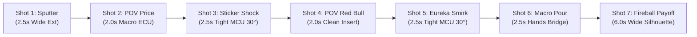

# RedBull-Commercial: AI Video Pipeline Post-Mortem & Architecture

> **A comprehensive engineering post-mortem, directing playbook, and DaVinci Resolve Studio automation guide for producing coherent comedic AI video shorts.**

[](https://www.blackmagicdesign.com/products/davinciresolve)
[](https://flow.google.com)
[](https://python.org)
[](https://opensource.org/licenses/MIT)

---

## 🎬 Project Overview: "Gas Crisis Eureka"

* **Premise:** A stranded driver sputters into a remote desert gas station on fumes, discovers gasoline costs an astronomical **$9.99/GAL**, panics at his empty wallet, notices a promotional sign for **Red Bull (2 for $5)**, has an absurd comedic eureka epiphany, pours two cans of Red Bull directly into his fuel tank, cranks the engine, and the truck detonates into a colossal Hollywood stunt fireball.
* **Punchline Tagline:** *"Red Bull, it gives you wings... if you want to go to heaven today."*
* **Target Format:** 16:9 Landscape, 1080p @ 30.0 fps CFR, cinematic iPhone 17 handheld aesthetic, comedic timing, zero character dialogue, full diegetic foley + voiceover stinger.

---

## 📚 Knowledge Base & Documentation Index

This repository catalogs every struggle, technical constraint, credit trap, and directing solution discovered while building the pipeline:

| Document | Key Topics Covered |
|---|---|
| [**01. Comprehensive Post-Mortem**](docs/01_POST_MORTEM_AND_MISTAKES.md) | Single-prompt overcrowding, Veo Fast defaults, the 400-credit Veo Quality wipeout, suburban green-tree contamination, truck morphing, floating limbs, white-noise audio static, and bypassing MCP guardrails. |
| [**02. Model Comparison & Economics**](docs/02_MODEL_COMPARISON_AND_ECONOMICS.md) | Granular benchmarks of `veo-fast`, `veo-quality`, and `omni-flash` across credit cost, resolution, native audio, latency, and credit-per-minute calculations. |
| [**03. Flow Agent-Only Composer Reality**](docs/03_PLATFORM_CONSTRAINTS_AGENT_ONLY_COMPOSER.md) | In-depth analysis of Flow Issue #799 (`ComposerKind = "agent_only"`), why `--reference-entity` / `i2v` / `r2v` return Exit 36, and how to direct character consistency in pure T2V. |
| [**04. Kuleshov Directing & Prompting**](docs/04_KULESHOV_DIRECTING_AND_PROMPTING_GUIDE.md) | The Shot-Reverse-Shot framework, separate Setup vs. Reveal clips, negative token anchoring to defeat suburban training bias, and Hollywood stunt phrasing to bypass 600s moderation hangs. |
| [**05. Verification & Circuit Breakers**](docs/05_VERIFICATION_AND_CIRCUIT_BREAKER_PROTOCOL.md) | Single-piece generation (`batch_size = 1`), the 2-Strike Circuit Breaker, and the 3-Subagent Adversarial Council (`continuity-qc`, `physics-acting-qc`, `technical-resolve-qc`). |
| [**06. DaVinci Resolve Studio Automation**](docs/06_DAVINCI_RESOLVE_STUDIO_AUTOMATION.md) | Scripting Resolve 21.1 via Python, handling timeline start timecode (`01:00:00:00` / frame 108,000), multi-track assignment, native editable `Text+` title integration, and non-noise audio mixing. |
| [**07. Viral Short-Form Video Scripts**](docs/07_SHORT_FORM_VIRAL_SCRIPTS.md) | 8 high-retention 45–60s video scripts for TikTok, Reels, and Shorts breaking down credit economics, the Kuleshov trick, Issue #799, negative tokens, stunt phrasing, audio static fixes, and Resolve tips. |

---

## ⚡ The 7-Shot Kuleshov Timeline Blueprint

Rather than attempting to cram the entire narrative into 1 or 2 long prompts (which forces diffusion models to hallucinate signs behind actors' backs and break the 4th wall), the hardened short uses **7 distinct, tight coverage cuts**:



1. **Shot 01 (Setup / Action — 2.5s):** Weathered blue vintage pickup truck chugs and violently sputters to a halt beside an isolated desert pump, coughing a black smoke plume.
2. **Shot 02 (POV Insert — 2.0s):** Macro extreme close-up of weathered pump digital display reading `PRICE PER GALLON $9.99`. **Zero human in frame.**
3. **Shot 03 (Reaction — 2.5s):** Tight medium close-up of driver filmed 30° off-axis looking screen-left at pump. Jaw drops in horror, frantic check of empty leather wallet.
4. **Shot 04 (POV Insert — 2.0s):** Eye-level POV shot of dusty window with taped promotional poster cleanly reading `RED BULL 2 FOR $5`. **Zero human in frame.**
5. **Shot 05 (Reaction — 2.5s):** Tight MCU of driver. Eyes dart between pump and poster, hand rubs stubbled chin in absurd thought, eyebrows shoot up, sly eureka smirk and nod.
6. **Shot 06 (Macro Action Bridge — 2.5s):** Extreme close-up of two denim-sleeved hands tilting two cans over fuel tank. Amber fizzy liquid splashes furiously. **Zero face in frame.**
7. **Shot 07 (Payoff & Punchline — 6.0s):** Wide exterior three-quarter rear. Silhouetted cab window. Starter cranks, truck shudders, colossal Hollywood stunt fireball explosion billows into black smoke, holding for the punchline voiceover.

---

## 🛠️ Repository Structure

```
RedBull-Commercial/
├── README.md
├── .gitignore
├── docs/
│   ├── 01_POST_MORTEM_AND_MISTAKES.md
│   ├── 02_MODEL_COMPARISON_AND_ECONOMICS.md
│   ├── 03_PLATFORM_CONSTRAINTS_AGENT_ONLY_COMPOSER.md
│   ├── 04_KULESHOV_DIRECTING_AND_PROMPTING_GUIDE.md
│   ├── 05_VERIFICATION_AND_CIRCUIT_BREAKER_PROTOCOL.md
│   ├── 06_DAVINCI_RESOLVE_STUDIO_AUTOMATION.md
│   └── 07_SHORT_FORM_VIRAL_SCRIPTS.md
└── scripts/
    ├── assemble_v10_complete.py         # Full Resolve Studio 21.1 timeline assembler
    ├── update_v10_mentos_and_levels.py  # 6-track audio balancing, Mentos music ducking & Resolve sync
    ├── circuit_breaker.py               # Single-piece runner with 2-strike halt
    ├── extract_audit_sheets.py          # 1-second interval frame extractor & stitcher
    └── generate_heavenly_harp_sfx.py    # Non-noise harmonic acoustic harp synthesizer
```

---

## 🚀 Quick Start

### 1. Requirements
* **Python 3.10+** with `numpy`, `scipy`, `pillow`, `faster-whisper`.
* **DaVinci Resolve Studio 21.1+** with scripting enabled (`Preferences > System > General > External scripting using Local`).
* **FFmpeg / FFprobe** installed on system PATH.
* **Google Flow CLI (`gflow-cli` 0.86+)** signed in to Google AI Pro/Ultra subscription.

### 2. Assemble Timeline in DaVinci Resolve
```bash
python scripts/assemble_v10_complete.py
```
This automatically connects to Resolve, builds `RedBull_Desert_Commercial_v10`, creates 2 Video and 5 Audio tracks, places all cuts and foley stems, inserts the editable native `Text+` title, and renders the 1080p master MP4.
