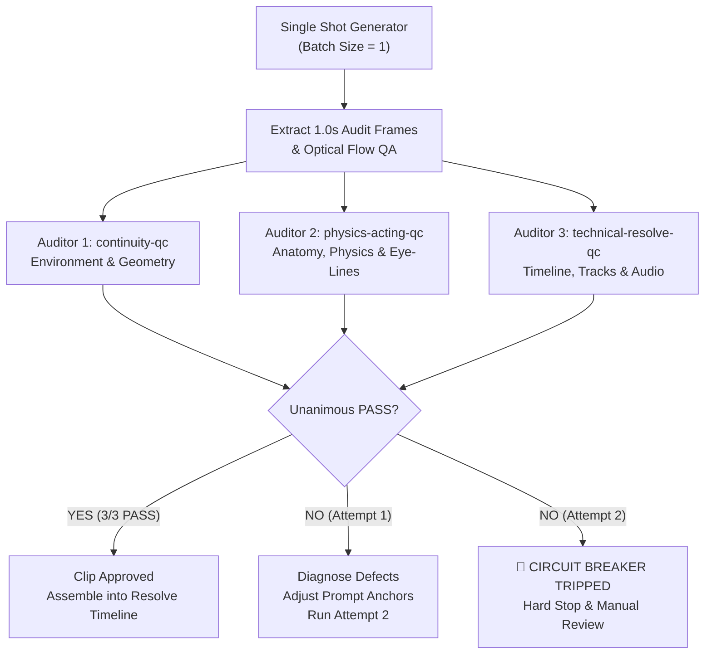

# 05. Verification & Circuit Breaker Protocol

> **The production safeguard system: Single-piece execution (`batch_size = 1`), the 2-Strike Circuit Breaker, and the 3-Subagent Adversarial Verification Council.**

---

## 1. The Core Problem: The Failure of Self-Verification

During early video generation cycles, the generating agent performed its own verification. This resulted in severe **confirmation bias**:
* The agent checked only return codes (`returncode: 0`).
* The agent glanced at thumbnails and focused exclusively on what went right (the actor made a funny face) while completely ignoring glaring defects (suburban green trees in a desert scene, a truck morphing into an entirely different model, floating arms, and missing DaVinci Resolve tracks).
* The agent declared premature victory ("masterpiece", "100% resolved"), forcing the user to conduct manual quality control.

To permanently eliminate this vulnerability, **verification is stripped from the generating agent** and delegated to an independent adversarial council.

---

## 2. The 3-Subagent Adversarial Council



### 2.1 Subagent Roles & Mandates

#### 1. `continuity-qc` (Environment & Continuity Auditor)
* **Mandate:** Hunt for setting drift, vehicle morphing, and wardrobe glitches.
* **Audit Rubric:**
  * Setting: Zero tolerance for trees, suburban grass, or city buildings in desert scenes.
  * Vehicle: Truck model, fenders, and color must remain identical. Gas pump must not vanish.
  * Wardrobe: Character must not sprout unrequested accessories (sunglasses, extra watches).
* **Verdict:** `PASS` or `FAIL` with timestamped defect description.

#### 2. `physics-acting-qc` (Physical & Anatomical Auditor)
* **Mandate:** Hunt for anatomical distortions, physics failures, and acting breakdown.
* **Audit Rubric:**
  * Anatomy: Count fingers on visible hands. Check joint connections. Zero floating arms.
  * Physics: Liquid must pour into an actual fuel neck, not splash on flat plastic engine covers.
  * Acting: Actor must look off-axis at props, not into camera lens. Comedic beat must register.
* **Verdict:** `PASS` or `FAIL` with timestamped defect description.

#### 3. `technical-resolve-qc` (Technical & Timeline Auditor)
* **Mandate:** Verify DaVinci Resolve Studio integration, audio mixing, and export codecs.
* **Audit Rubric:**
  * Resolve GUI: Tracks V1, V2, A1, A2, A3, A4, A5 must be physically populated.
  * Audio Waveform: Zero synthetic white-noise hiss (`np.random.randn`). Clean foley J/L cuts.
  * Codec: Exact 1920x1080 @ 30.0 fps CFR delivery.
* **Verdict:** `PASS` or `FAIL` with timestamped defect description.

---

## 3. The 2-Strike Circuit Breaker Specification

```
┌─────────────────────────────────────────────────────────────────────────────┐
│                       CIRCUIT BREAKER EXECUTION LOGIC                       │
├─────────────────────────────────────────────────────────────────────────────┤
│ 1. Shot Request Received (e.g. Shot 03: Reaction Shock)                     │
│ 2. Attempt 1 Generated (1 clip, cost logged in ledger)                      │
│ 3. Frames Extracted at 1.0s intervals                                      │
│ 4. Verification Council Invoked:                                            │
│    • continuity-qc        ──► VOTE                                          │
│    • physics-acting-qc    ──► VOTE                                          │
│    • technical-resolve-qc ──► VOTE                                          │
│                                                                             │
│ [CASE A: 3/3 UNANIMOUS PASS]                                                │
│   ──► Clip Approved. Placed on timeline. Next shot unlocked.                │
│                                                                             │
│ [CASE B: Attempt 1 FAILS on any rubric]                                     │
│   ──► Strike 1 logged.                                                      │
│   ──► Defect Analysis: e.g. "continuity-qc flagged suburban green trees".    │
│   ──► Prompt hardened with negative token anchors.                          │
│   ──► Attempt 2 Generated. Council re-audits.                              │
│                                                                             │
│ [CASE C: Attempt 2 FAILS on any rubric]                                     │
│   ──► Strike 2 logged.                                                      │
│   ──► 🚨 CIRCUIT BREAKER TRIPPED!                                           │
│   ──► HARD STOP. Zero additional credits spent.                             │
│   ──► Incident Report generated with side-by-side audit frames.             │
│   ──► Present options to USER:                                              │
│       Option 1: Pivot shot framing (e.g. switch to macro or off-axis crop). │
│       Option 2: Recut existing approved assets in Resolve (0 credits).       │
│       Option 3: Declare shot technically infeasible under current model.     │
└─────────────────────────────────────────────────────────────────────────────┘
```

### Inviolable Rules
1. **Never attempt a 3rd generation automatically.**
2. **Never proceed to Shot N+1 if Shot N has not passed verification.**
3. **Never bypass credit caps or logging.**
